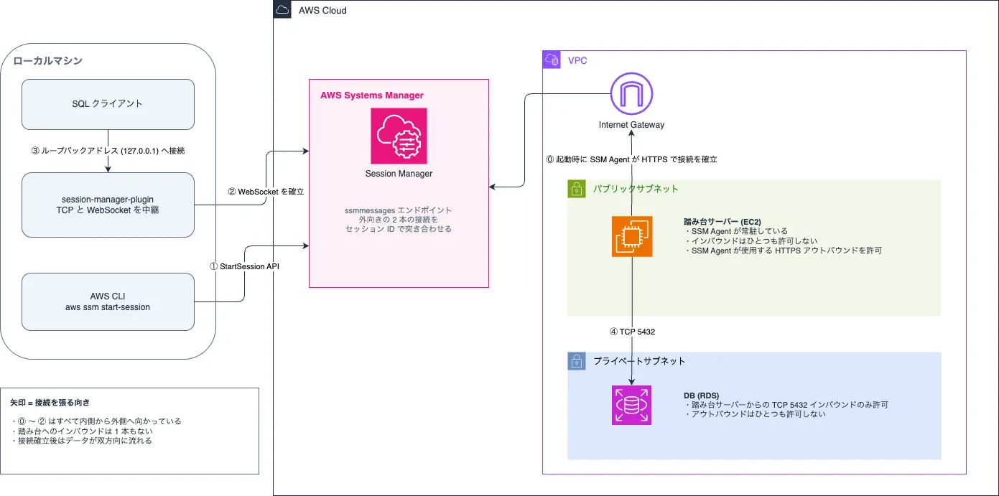

外部ネットワークからプライベートサブネットに配置された RDS へ安全に接続するには、踏み台サーバーのようなトンネリングの仕組みが必要です。従来、踏み台サーバーの構成には SSH ポートを公開する手法が使われてきました。しかし、EC2 インスタンスや SSH キーの管理に課題があり、現在では [AWS Systems Manager Session Manager](https://docs.aws.amazon.com/systems-manager/latest/userguide/session-manager.html) (以下 SSM Session Manager) の利用が推奨されています。

この記事ではローカルマシンの SQL クライアントから RDS まで繋がる仕組みを押さえつつ、比較的安価に運用できる踏み台サーバーの構成を紹介します。

## 紹介する構成の特徴

従来の手法と比べるとセキュアで運用コストが安くなります。一方で SSM Session Manager を用いた他の手法と比べた場合、その特徴をひとことで言うと「安いがセキュリティは割り切っている」になると思います。

### 従来の踏み台サーバーと比べた場合

SSM Session Manager 導入のメリットがそのまま得られます。

- SSH ポートの公開、それに付随する SSH キーの管理が不要になる
- 踏み台サーバーの管理コストを削減できる
- etc.

### SSM Session Manager を用いた他の手法と比べた場合

使用するサービスが少なく済みますが、踏み台サーバーがパブリックサブネットに配置されます。

- NAT ゲートウェイまたは VPC エンドポイントが不要になる
- 時間単位で発生する課金がほぼ踏み台サーバーの稼働時間のみで決まるため、比較的に安くあがる
- 防御はセキュリティグループの 1 枚岩になり他の手法に劣る

## 構成図

手元の開発マシンからプライベートサブネット内の RDS に繋がるまでの仕組みを理解するには、SSM Session Manager を中心とした全体像とその構成要素を押さえておくのが良いと思います。


_SSM Session Manager を中心とした踏み台サーバーの構成_

## 構成要素

VPC 周りは省略しますが、以下のような構成要素があります。

### SSM Session Manager

AWS クラウド上で管理されるフルマネージドサービス。開発者が使用するローカルマシンと踏み台サーバー間に入り、双方向の通信を中継する。

### 踏み台サーバーと SSM Agent

SSM Session Manager を使用したからといって、踏み台サーバーが不要になるわけではない。踏み台サーバーに使用する EC2 インスタンスのイメージ (Amazon Linux 2023) には SSM Agent がプロセスとして常駐するため、適切なポリシーを割り当てることで SSM Session Manager とやり取りができる。

https://docs.aws.amazon.com/aws-managed-policy/latest/reference/AmazonSSMManagedInstanceCore.html

### ローカルマシン

[Session Manager plugin](https://github.com/aws/session-manager-plugin) と [AWS CLI](https://aws.amazon.com/cli/) のインストールが必要。AWS CLI は SSM Session Manager にセッション開始を要求し、受け取った接続情報をプラグインに渡す。プラグインは ssmmessages エンドポイントとの間に WebSocket を開く。ポートフォワーディングにより、SQL クライアントからのリクエストは接続先のネットワークを意識する必要なく RDS まで到達できる。

### RDS

プライベートサブネットに配置されるため、踏み台サーバーを経由しないと接続できない。ここでは DBMS に PostgreSQL を使用する。

## どう繋がるのか

各接続が確立されるタイミングとセキュリティグループの仕様を理解するのが重要です。

1. 踏み台サーバー起動時に SSM Agent が起動し、SSM Session Manager の [ssmmessages](https://docs.aws.amazon.com/systems-manager/latest/userguide/systems-manager-setting-up-messageAPIs.html#message-services) エンドポイントとコントロールチャネルを確立
2. `aws ssm start-session` を実行すると、Session Manager plugin が ssmmessages エンドポイントとの間にデータチャネル (WebSocket) を確立
3. SQL クライアントからのリクエスト (TCP 5432) はデータチャネルを中継して踏み台サーバーに到達し、踏み台サーバーを経由して RDS まで届く

```shell
## 踏み台サーバーのインスタンス ID を取得
BASTION_ID=$(aws ec2 describe-instances \
  --filters "Name=tag:Name,Values=ssm-production" \
  --query 'Reservations[0].Instances[0].InstanceId' --output text)

## 踏み台サーバーを起動し、SSM に登録されるまで待つ
aws ec2 start-instances --instance-ids $BASTION_ID
aws ec2 wait instance-running --instance-ids $BASTION_ID
until aws ssm describe-instance-information \
  --filters "Key=InstanceIds,Values=$BASTION_ID" \
  --query 'InstanceInformationList[0].PingStatus' \
  --output text 2>/dev/null | grep -q "Online"; do sleep 10; done

## RDS のアドレスを取得
ENDPOINT=$(aws rds describe-db-instances \
    --db-instance-identifier yukumichi-db \
    --query 'DBInstances[0].Endpoint.Address' --output text)

## セッション開始
aws ssm start-session \
  --target "$BASTION_ID" \
  --document-name AWS-StartPortForwardingSessionToRemoteHost \
  --parameters "host=$ENDPOINT,portNumber=5432,localPortNumber=15432"
```

:::message
セキュリティグループはステートフルであり、SSM Agent が自分から張った通信を記憶します。そのため、応答として返ってくる通信はインバウンドを一切許可していなくてもブロックされません。
https://docs.aws.amazon.com/vpc/latest/userguide/vpc-security-groups.html
:::

## なぜ踏み台サーバーを経由しないと繋がらないのか

ここでは構成図で省略したセキュリティ設定について、Terraform モジュールのコードを引用しながら説明します。

踏み台サーバーはパブリックサブネットに配置されるため、何も対策しなければ外部からアクセスし放題になってしまいます。そこでリソース単位のセキュリティ設定であるセキュリティグループを使います。セキュリティグループは許可リスト方式のため、「通信の方向 (インバウンド or アウトバウンド) / 許可する通信プロトコル (TCP or UDP) / ポート番号 / 送信元 or 宛先」の範囲をセットで指定することで意図的に通信を許可します。

つまり、踏み台サーバーのセキュリティグループでインバウンドルールを設定しなければ、総当たり攻撃などを受けません。この点で従来の SSH ポートを公開する手法よりも優れていると言えます。

```tf
# 踏み台サーバーのセキュリティグループ
resource "aws_security_group" "this" {
  name        = "ssm-${var.environment}"
  vpc_id      = var.vpc_id
}

# 踏み台から RDS への TCP 5432 アウトバウンドを許可
resource "aws_vpc_security_group_egress_rule" "rds" {
  security_group_id = aws_security_group.this.id

  referenced_security_group_id = var.rds_security_group_id
  from_port                    = 5432
  to_port                      = 5432
  ip_protocol                  = "tcp"
}

# 踏み台からすべての宛先への HTTPS アウトバウンドを許可
resource "aws_vpc_security_group_egress_rule" "ssm" {
  security_group_id = aws_security_group.this.id

  cidr_ipv4   = "0.0.0.0/0"
  from_port   = 443
  to_port     = 443
  ip_protocol = "tcp"
}

# 踏み台 から RDS への TCP 5432 インバウンドを許可
resource "aws_vpc_security_group_ingress_rule" "rds_from_bastion" {
  security_group_id = var.rds_security_group_id

  referenced_security_group_id = aws_security_group.this.id
  from_port                    = 5432
  to_port                      = 5432
  ip_protocol                  = "tcp"
}
```

また、SSM Session Manager に接続するためには `AmazonSSMManagedInstanceCore` ポリシーをアタッチしたロールを作成し、EC2 に IAM インスタンスロールとして設定します。ポリシーには `ssmmessages:OpenControlChannel` がアクションとして許可されているため、踏み台サーバーの起動時にコントロールチャネルを確立できるという訳です。

```tf
# 踏み台サーバーの IAM ロール
resource "aws_iam_role" "this" {
  name = "ssm-${var.environment}"

  assume_role_policy = jsonencode({
    Version = "2012-10-17"
    Statement = [
      {
        Effect = "Allow"
        Principal = {
          Service = "ec2.amazonaws.com"
        }
        Action = "sts:AssumeRole"
      }
    ]
  })
}

# 上記のロールにポリシーをアタッチ
resource "aws_iam_role_policy_attachment" "ssm" {
  role       = aws_iam_role.this.name
  policy_arn = "arn:aws:iam::aws:policy/AmazonSSMManagedInstanceCore"
}

# EC2 にアタッチするためのインスタンスプロファイル
resource "aws_iam_instance_profile" "this" {
  name = "ssm-${var.environment}"
  role = aws_iam_role.this.name
}

```

## なぜ安く上がるのか

SSM Agent は Systems Manager の `ssm` と `ssmmessages` エンドポイントへ HTTPS で到達できる必要があります。プライベートサブネットにはインターネットに出る経路がないため、踏み台サーバーをそこに配置するには VPC エンドポイントや NAT ゲートウェイを用いて専用の経路を用意しなければなりません。

この記事で紹介した方法の他に恐らく 3 経路があり、時間で発生する課金が大きな差になります。

| 経路                                  | 踏み台の配置           | 時間で発生する課金                                 |
| ------------------------------------- | ---------------------- | -------------------------------------------------- |
| インターネットゲートウェイ (この構成) | パブリックサブネット   | 踏み台サーバーの稼働中のみパブリック IPv4 アドレス |
| VPC エンドポイント                    | プライベートサブネット | エンドポイントごとの時間課金 + トラフィック量      |
| NAT ゲートウェイ                      | プライベートサブネット | ゲートウェイごとの時間課金 + トラフィック量        |

この記事で紹介した構成は踏み台サーバーを使用していない間に停止しておくことで、常時発生する課金を大幅に抑えることができます。一方で VPC エンドポイントと NAT ゲートウェイは踏み台を停止している間も課金が続くので、使う時だけ起動する運用が成立しなくなります。

:::message
EC2 と EBS の課金はどの経路でも発生します (EBS は停止中も継続)。また、インターネットゲートウェイには時間課金がありません。
:::

## おわりに

踏み台サーバーのように、運用上必要だが本番環境には影響しないリソースはなるべく安く運用したいです。なかなか難しいですが、AWS についてもトレードオフの有無を正確に把握しつつ、適切な判断できるようになっていきたいと思います。
