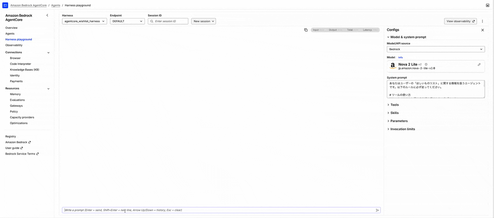
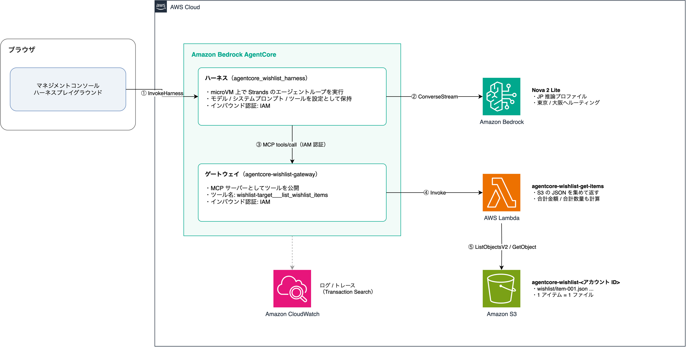
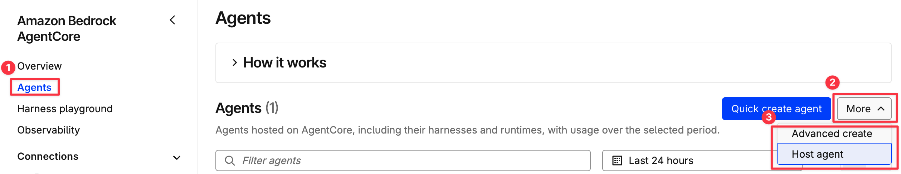
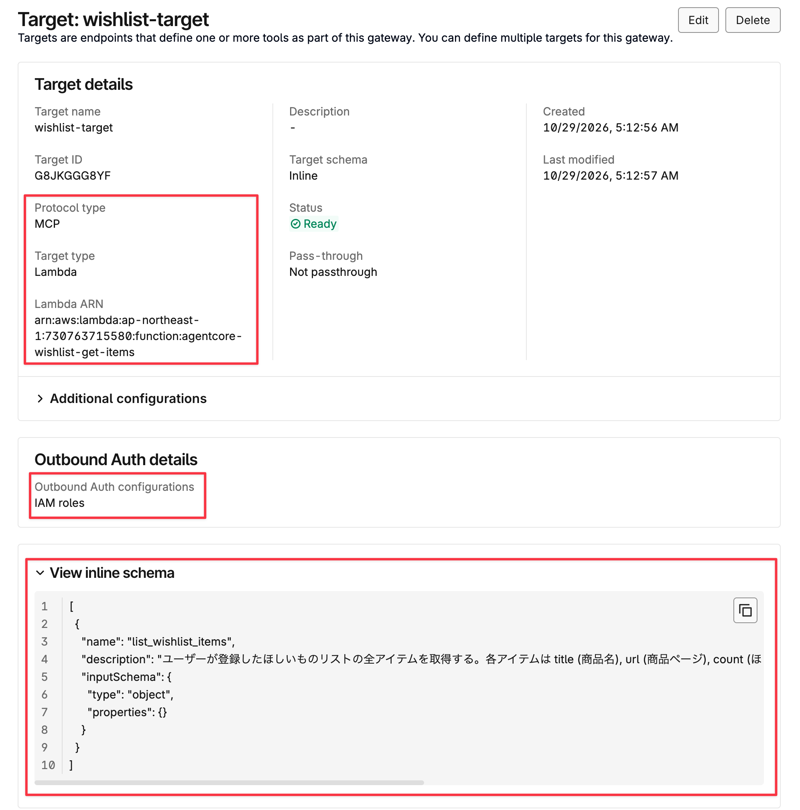
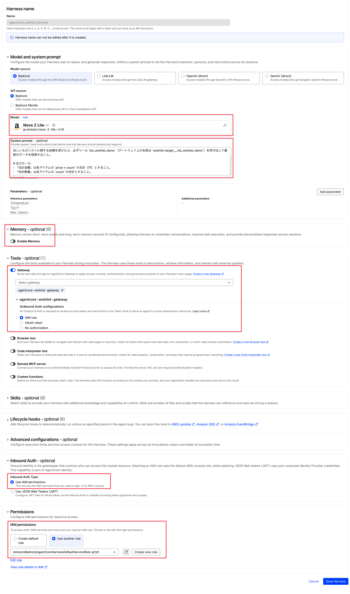
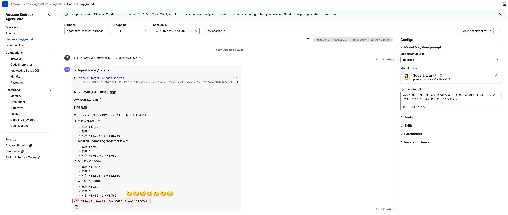
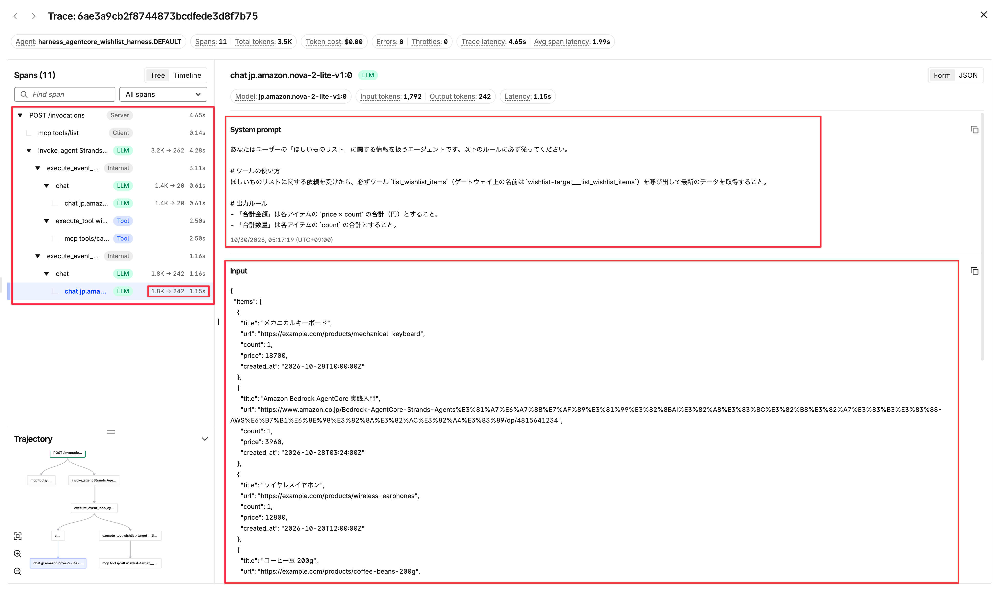

最近は AI エージェントを組み込んだプロダクトの開発も増えてきたのではないでしょうか。開発に Claude Code といった AI コーディングエージェントを活用したり、AI エージェントと疎通する部分は何となく想像できても、その裏側がどのように動いているのかは想像がついていませんでした。アプリケーションエンジニアとして隣接領域をちょっとでも知っておきたいと思い、今回は [Amazon Bedrock AgentCore](https://aws.amazon.com/bedrock/agentcore/) に入門していきます。

## はじめに

この記事で構築するのは、AWS 上で完結する AI エージェントとのチャット環境です。マネジメントコンソール上で動くプレイグラウンドにはチャット UI が実装されており、その中で Bedrock のモデル (LLM) と対話できます。



AI 周りの用語や AgentCore の基礎については、下記の記事を読むと理解が深まりました。

https://zenn.dev/yoshipon_tech/articles/a51bbfcc068c1f
https://dev.classmethod.jp/articles/Illust-bedrock-agentcore/

## 全体像

これからつくるのは LLM を動かして遊ぶのに最低限の環境で、AgentCore を中心にツールやモデル、ログを扱う複数の AWS サービスから構成されます。後述しますが、AgentCore にはハーネスとランタイムがあり、今回はより AWS が広範囲で面倒を見てくれるハーネスの方を使います。



## ランタイムとハーネス

ここで簡単に AgentCore ランタイムと AgentCore ハーネスの違いに触れておきます。イメージとしてはハーネスがランタイムを包括したサービス (モデル、メモリー、ツール、スキルなどを含む) であり、ランタイムはエージェントを動かす環境 (フレームワーク) を自由にカスタマイズできるインフラサービスです。
例えば、AgentCore ランタイム上で Claude をモデル (LLM) として動かす場合、エージェントが動く環境を自由にプログラミングできます。それにより、エージェントの返すレスポンスの JSON スキーマを固定する [Structured outputs](https://docs.aws.amazon.com/bedrock/latest/userguide/claude-messages-structured-outputs.html) といったユースケースに応じたカスタマイズが可能になります。一方、ハーネスで構築する場合は既定のフレームワーク ([Strands Agents](https://strandsagents.com/)) に固定されてしまうため、内部のループ処理などは自分たちで制御することができません。その分ハーネスは ECR を経由したコンテナデプロイが不要になるなど AWS が面倒を見てくれる範囲が広がるので、用途に応じた使い分けが必要なのかと思いました。

以下の対応表を参考にしてハーネスに寄せられると、その分運用面では楽ができそうです。

https://docs.aws.amazon.com/bedrock-agentcore/latest/devguide/harness-vs-runtime.html

マネジメントコンソールの UI は初見だと分かりにくかったので少し補足します。Bedrock AgentCore のページを開き、「Agents > More」から「Advanced create」を選択するとハーネスをカスタマイズしながら作成できる画面に遷移します。「Host agent」を選択した場合はランタイムを作成できる画面に遷移します。



:::message
「Quick create agent」からハーネスを作成すると、ワンクリック (設定項目がすべて埋まった状態) で箱ができあがります。詳細は後から編集可能です。
:::

## ハーネスの構築

それではハーネスの構成要素を順に紹介しながら、実際に構築していきます。

### ツール

普段の開発でも MCP Server といったツールを AI エージェントに使わせていると思います。Bedrock 上で動くモデル (LLM) にも同じように手足として使えるツールを与えることで、単に自然言語を上手に扱えるだけではなく、専門的なタスクも任せられるようになります。ツールには MCP ツールだけでなく、HTTP エンドポイントや他のエージェントまで指定できるようですが、ここでは扱いが簡単な MCP ツールとして Lambda 関数を実装します。

関数の実装としては、S3 バケットにある「ほしいものリスト」のデータを一覧として取得するだけのシンプルなコードです。Lambda の実装は重要ではないので、読み飛ばしていただいて構いません。

:::details Lambda 関数の実装

```js
import {
  GetObjectCommand,
  ListObjectsV2Command,
  S3Client,
} from "@aws-sdk/client-s3";

const s3 = new S3Client({});

const BUCKET = process.env.WISHLIST_BUCKET;
const PREFIX = process.env.WISHLIST_PREFIX;

export const handler = async (event, context) => {
  const items = await getWishlistItems();

  return { items };
};

const getWishlistItems = async () => {
  const objectKeys = [];
  let continuationToken;

  do {
    const page = await s3.send(
      new ListObjectsV2Command({
        Bucket: BUCKET,
        Prefix: PREFIX,
        ContinuationToken: continuationToken,
      })
    );
    for (const object of page.Contents ?? []) {
      if (object.Key.endsWith(".json")) {
        objectKeys.push(object.Key);
      }
    }
    continuationToken = page.NextContinuationToken;
  } while (continuationToken);

  const items = await Promise.all(
    objectKeys.map(async (objectKey) => {
      const object = await s3.send(
        new GetObjectCommand({ Bucket: BUCKET, Key: objectKey })
      );
      const body = await object.Body.transformToString();

      return JSON.parse(body);
    })
  );

  return items.sort((a, b) => b.created_at.localeCompare(a.created_at));
};
```

:::

:::details レスポンスの例

```json
{
  "items": [
    {
      "title": "メカニカルキーボード",
      "url": "https://example.com/products/mechanical-keyboard",
      "count": 1,
      "price": 18700,
      "created_at": "2026-10-28T10:00:00Z"
    },
    {
      "title": "Amazon Bedrock AgentCore 実践入門",
      "url": "https://www.amazon.co.jp/dp/4815641234",
      "count": 1,
      "price": 3960,
      "created_at": "2026-10-28T03:24:00Z"
    },
    {
      "title": "ワイヤレスイヤホン",
      "url": "https://example.com/products/wireless-earphones",
      "count": 1,
      "price": 12800,
      "created_at": "2026-10-20T12:00:00Z"
    },
    {
      "title": "コーヒー豆 200g",
      "url": "https://example.com/products/coffee-beans-200g",
      "count": 2,
      "price": 1680,
      "created_at": "2026-10-15T09:30:00Z"
    }
  ]
}
```

:::

### ゲートウェイ

ゲートウェイはモデル (LLM) がツールを参照する際の窓口に当たります。先ほど作成した MCP ツールの実体は Lambda 関数ですが、ツールの参照にゲートウェイを経由することで、モデル (LLM) は内部がどうなっているかを意識することなく Lambda 関数を MCP ツールとして利用できます。その他にもモデルにツールの一覧を提供するなど、ツールの抽象レイヤーとして機能するようです。

:::message
ゲートウェイはツールの一覧を `${target_name}___${tool_name}` 形式で名前付けして管理します。例えば、ほしいものリストを取得する MCP ツールはモデルから `wishlist-target___list_wishlist_items` のように見えます。

https://docs.aws.amazon.com/bedrock-agentcore/latest/devguide/gateway-tool-naming.html
:::

設定項目としては、以下の 3 つがポイントになります。

- Targets: MCP ツールとして Lambda 関数を追加
  - インラインスキーマ: ツールの説明 (名前と説明、入力インターフェースなど)
  - `description` フィールドは `.mcp.json` でよく見るツールの呼び出し判断に関わってくる説明
- Inbound Auth: ツールを呼び出す際の認可方式として IAM を使用
- Outbound Auth: ゲートウェイの呼び出し側に求める認可方式として IAM を使用



### ハーネス

ハーネスにはモデル (LLM)、メモリー、ツール、スキルといった AI エージェントの挙動を左右する重要な設定項目が複数あり、これらを適切に組み合わせて挙動をコントロールするのが LLM エンジニアの仕事の一部なのかと思いました。また、画面からは見えませんがハーネスを作成すると microVM 上で動作するランタイムが定義されているはずで、その内部では AI エージェントの動作環境がフレームワークによって構築されるのだと理解しています。

注目すべき設定項目は、以下の 5 つです。

- Model and system prompt: モデルは Nova 2 Lite。システムプロンプトには、エージェントの役割とほしいものリストの使い方を記載
- Memory: モデルの長期記憶に必要。今回は時間単位の課金を発生させたくないので意図的にオフ
- Tools: ゲートウェイを設定
- Inbound Auth: ゲートウェイを呼び出す際の認可方式として IAM を使用
- Permissions: 「Create default role」を選択したらゲートウェイの実行権限を持つロールを作成してくれた



## AI エージェントと対話してみる

ここまでの手順で AWS 上に AI エージェントの実行環境を構築できました。「Harness playground」タブでは、作成した AI エージェントとチャットで対話できます。試しにほしいものリストの合計金額を聞いてみましょう。



自然言語で返答があって良さげですね！合計金額を見てみると...

なぜか普通に間違ってますね (合計金額は 38,820 円のはず)。謎ですが、何回やっても間違えます。システムプロンプトくらいしか改良の余地はありませんが、特におかしなところもなく詰みました。以下は入力したシステムプロンプトです。

```
あなたはユーザーの「ほしいものリスト」に関する情報を扱うエージェントです。以下のルールに必ず従ってください。

# ツールの使い方
ほしいものリストに関する依頼を受けたら、必ずツール `list_wishlist_items`（ゲートウェイ上の名前は `wishlist-target___list_wishlist_items`）を呼び出して最新のデータを取得すること。

# 出力ルール
- 「合計金額」は各アイテムの `price × count` の合計（円）とすること。
- 「合計数量」は各アイテムの `count` の合計とすること。
```

LLM のこういった非決定的な挙動をどう制御するのか (重要な部分では安全に倒すのかなど) を評価・検証しながら改善していくには、やはり専門的な知見が必要なのだと思いました。

ちなみにオブザーバビリティを有効にしておくと、Trace (チャットの 1 往復) 単位でログを確認できます。普段 AI コーディングエージェントを使った開発をしていると馴染みの挙動が可視化されており、なかなか面白いです。



1. ハーネスに `POST /invocations` リクエストが飛ぶ
2. MCP ツールのリストがモデル (LLM) のコンテキストに読み込まれる
3. モデル (LLM) が `invoke_agent Strands Agents` でループを開始
4. イベントループサイクル `execute_event_loop_cycle` の中でモデルにシステムプロンプトとユーザー入力プロンプトが渡される
5. モデルは指示を理解して、`execute_tool wishlist-target___list_wishlist_items` を実行。ツールはほしいものリストを返す
6. 2 周目のイベントループサイクルでは、「4」の入力に加えて「5」で取得したほしいものリストの JSON もコンテキストに含まれる
7. モデルがループ終了を判断して、結果を出力する

## おわりに

Amazon Bedrock AgentCore のハーネスはマネージドな部分が多く、AI エージェントのインフラをミリしらの状態から学ぶには良い題材だと思いました。また、思いがけない挙動から気づきを得たり、少しだけ LLM エンジニアの仕事が想像しやすくなったのが良かったです。
